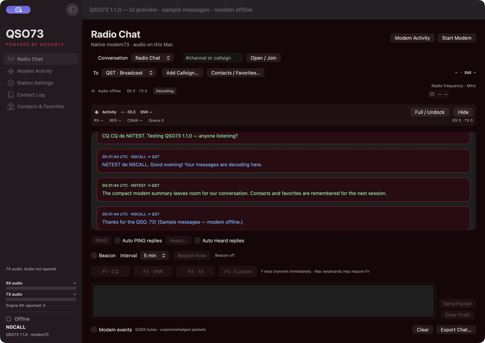

# QSO73

[](https://github.com/N4EAC/QSO73/releases/tag/v1.1.0)
[](https://github.com/N4EAC/QSO73/releases/tag/v1.1.0)

QSO73 is an amateur-radio chat client using the bundled modem73 engine. It provides broadcast packet chat, channels and topics, direct conversations, beacons, PING/SNR replies, Heard queries and optional PSK Reporter reception reporting.

## Download version 1.1.0

Both platforms are published in the **[same 1.1.0 release](https://github.com/N4EAC/QSO73/releases/tag/v1.1.0)**.

| Platform | Download | Status |
| --- | --- | --- |
| macOS 13+, Apple Silicon | [QSO73 1.1.0 DMG](https://github.com/N4EAC/QSO73/releases/download/v1.1.0/QSO73-1.1.0-macOS-arm64.dmg) | Development build, ad-hoc signed |
| Windows 10 (1903+) / Windows 11, x64 | [QSO73 1.1.0 portable ZIP](https://github.com/N4EAC/QSO73/releases/download/v1.1.0/QSO73-1.1.0-windows-x64-portable.zip) | **Testing** |

Download the DMG or ZIP for your platform. Source-code ZIPs are not ready-to-run applications. macOS is not notarized; Intel Mac builds are not supplied. Windows is unsigned and remains a testing build. Preserve settings and personal contact files when replacing an existing installation.

## New in 1.1.0

- **Compact docked activity on macOS:** a two-line summary inside Radio Chat keeps the transcript usable. The full dashboard remains available from Modem Activity or Full / Undock, with Keep on Top in the detached window.
- **Saved contacts and favorites on both platforms:** received callsigns, last-heard times and known grids survive relaunch. Favorites appear separately and first in the To menu. Clear contacts preserves favorites; individual Delete removes one station; Full reset erases the directory and all favorites after confirmation.
- **Offline contact map:** open Contact Map in your browser, with retained callsigns pinned at their Maidenhead grid centers. Unknown locations remain listed without a pin. Pan, zoom and select a callsign to center it. The map uses bundled public-domain Natural Earth outlines and needs no account, API key or network connection.
- **Default, CP and Crimson themes:** saved theme choices apply to the clients and newly opened map snapshots. Crimson uses deep burgundy and rose/red accents.
- **Unified version:** macOS and Windows both identify as 1.1.0, including beacon and ADIF version metadata.



The screenshot uses sample messages in an isolated offline preview; it is not an over-the-air test result.

## User manual

Read the [PDF manual](docs/QSO73-User-Manual.pdf) or [Markdown manual](USER_MANUAL.md). The current 24-page manual is included in both packages and as a release asset. Page 24 covers saved contacts, favorites, deletion/reset and the map. See the [Windows setup guide](windows/README.md) and [validation report](windows/TEST_RESULTS.md).

## Radio setup

Select the radio's audio input/output, modem family/mode and PTT method. Bundled Hamlib/rigctld can manage CAT, frequency and PTT; select the correct model, serial/COM port and baud. Check radio USB audio routing and receive levels before transmission. The modem processes 48 kHz internally and converts supported hardware audio rates, including 44.1 kHz USB devices.

Both operators must use compatible modem modes and the same RF/audio configuration. Channels/direct conversations use QSO73's application protocol over ordinary AX.25 packets; messages have no delivery acknowledgment and are readable over the air. Plain Radio Chat retains packet compatibility. Configure your licensed callsign and grid before transmitting. F1–F4 transmit immediately; beacons, automatic PING and Heard replies share radio airtime.

The Windows package includes the official Hamlib 4.7.2 runtime, dependencies and corresponding sources. No separate Hamlib installation or PATH change is needed. Stop Modem releases the owned modem/CAT processes while keeping the client open.

## Personal records

The callsign directory is separate from completed QSOs in **Contact Log**. Directory Clear/Delete/Full reset do not erase the ADIF log or chat. New radio traffic can add an erased callsign again. Grids come from received beacons/PING replies or manual entry; a callsign alone does not provide a location.

macOS stores the directory and contacts in QSO73 preferences. Windows stores **station-directory.json**, **contacts.json** and **settings.json** beside QSO73.exe. Keep these files when replacing the portable folder; personal files are excluded from distributed ZIPs. Reopen the local HTML map after contact/theme changes to refresh its snapshot.

Contact Log exports ADIF 3.1.6 with UTC times, callsign, MHz frequency, derived band and MODE=PKT. Review contacts, export .adi and use TQSL to sign and submit to LoTW with your certificate/station location. QSO73 does not upload unsigned ADIF.

## Build and validation

macOS requires Xcode Command Line Tools:

```sh
./build.sh
./test.sh
./tools/check_chat_scroll.sh
./tools/check_contact_layout.sh
```

Windows cross-build from macOS requires MinGW-w64:

```sh
./windows/build.sh
./windows/test-mac-interop.sh
```

See [Windows instructions](windows/README.md) for the native build entry point. Packet interoperability, modem DSP, CAT simulations, chat regressions, directory persistence/deletion, ADIF field lengths, map grid math/label safety and portable dependency checks are covered locally. These checks do not replace Windows GUI/hardware or two-station radio testing.

Modem updates remain independent of the client where the engine interface is compatible. Full diagnostics and engine source/notices are preserved. See [macOS notices](THIRD_PARTY_NOTICES.md), [Windows notices](windows/THIRD_PARTY_NOTICES.md), [chat protocol](CHAT_PROTOCOL.md) and [activity data](ACTIVITY_DATA.md).
